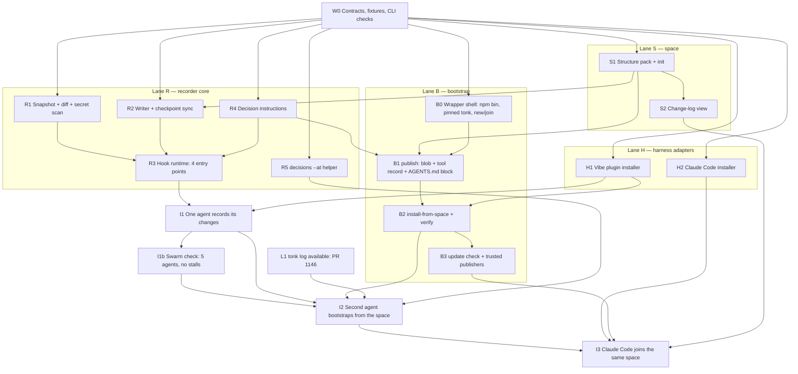

# Spec — a Tonk space that records every agent's code changes, and installs its own recorder

Status: draft v3, 2026-11-21. Nothing built yet. Supersedes v1 (shared
SKILL.md, separate installer) and v2 (recorder run from this repo, custom
replay command).

## 1. What it does

Someone is vibe coding in their own harness (Mistral Vibe first, Claude Code
next). Their project is bound to a Tonk space. From then on, **every change any
agent makes is recorded in the space** — by the harness's own hooks, with no
cooperation from the agent.

Any new agent invited in needs only two things: the `tonk` CLI (npm) and an
invite link. **The recorder itself lives in the space.** Joining the space is
how the agent gets the recorder, installs it into its harness, and starts
recording.

The whole thing is **one small utility wrapped around the `tonk` CLI**
(working name `<wrapper>`). It does three things:

1. **join** — create or join a space and install itself into the harness;
2. **hook** — the entry points the harness calls to record changes;
3. **instructions** — tell the agent how to add extra decisions by hand with
   plain `tonk` commands.

**Replay is not part of the utility.** Reading history back is `tonk log`
(tonk PR #1146, §7).

v1 records the **whole change** per turn, plus decisions agents or people add
by hand. Automatically summarising changes into architectural decisions, agent
registry / roles / spawning, and video are later phases (§10).

## 2. Distribution

**The npm wrapper is a thin loader; the space holds the logic.**

| Piece | Where it comes from | Who publishes it |
|---|---|---|
| `tonk` CLI | npm `@tonk/cli`, a pinned dependency of the wrapper | Tonk |
| **Wrapper** (`<wrapper>`) | npm, run as `npx --yes <wrapper> …`; built as one self-contained file | us |
| **Logic** (the same single file: hooks, structure pack, instructions) | **a blob in the space** + a `tool` record pointing at it | whoever creates the space, automatically, at `new` |
| Bootstrap instructions | the space's AGENTS.md (`tonk space agents get`) | written at `new` / `publish` |

- The wrapper calls `tonk` as a child process. It uses its own pinned
  `@tonk/cli`, never whatever `tonk` is on PATH (`TONK_BIN` overrides, for
  running a branch build).
- Every agent in a space runs the logic version **stored in that space**,
  fetched and sha256-checked — so all agents in a space behave the same, and
  updating a space is publishing a new version into it.
- An agent without the npm wrapper can still bootstrap from the space with
  only `tonk` and a link (§3.3).

## 3. Commands and bootstrap flow

| Command | What it does |
|---|---|
| `<wrapper> new <name>` | `tonk space new`; load the structure pack; store the logic in the space (`blob add` + `tool` record + AGENTS.md block); install hooks into this harness; print the paste line for inviting others |
| `<wrapper> join '<link>'` | `tonk join`; fetch the space's logic; verify sha256 + publisher; install hooks |
| `<wrapper> hook <event>` | called by the harness (§6) |
| `<wrapper> instructions` | print the "how to add a decision" text (§6.7) |
| `<wrapper> publish` | store a new logic version in the space (trusted publishers only) |
| `<wrapper> sync` | run a checkpoint now: `tonk pull` + `tonk push` (§6.5) |
| `<wrapper> invite` / `status` / `uninstall` | wrap `tonk invite`; show binding + hook state; remove hooks and local state |

There is no `replay` command: use `tonk log` (§7).

### 3.1 Creator, once

```sh
cd <project>
npx --yes <wrapper> new <name>
```

`new`:
1. `tonk space new <name>` and bind the project folder to it;
2. loads the structure pack (concepts §5), idempotent, versioned;
3. publishes the logic: `tonk blob add` → `blob:<hash>`; asserts a `tool`
   record (name, version, blob ref, sha256, publisher); marks the creator as a
   trusted publisher; writes the bootstrap block and the decision instructions
   into the space AGENTS.md (`tonk space agents set`);
4. installs the hooks into the creator's harness (§4);
5. prints the paste line for inviting others.

### 3.2 Every agent that joins

One paste line, with an invite made by `<wrapper> invite`:

```sh
npx --yes <wrapper> join '<link>' --agent-name <name>
```

`join` runs `tonk join`, reads the latest `tool` record, fetches the blob,
checks sha256 and publisher, installs the hooks. From the next session on,
that agent's changes are recorded. Nothing else to set up.

### 3.3 Joining without the wrapper

With only `tonk` and a link:

```sh
npx --yes @tonk/cli join '<link>' --agent-name <name> && npx --yes @tonk/cli space agents get
```

(`tonk join` does not print the space AGENTS.md itself, hence the second
command.) The AGENTS.md starts with the bootstrap block, which the agent runs:

```sh
# Tonk recorder bootstrap — generated; do not edit
mkdir -p ~/.tonk/tools/<wrapper>/<version>
npx --yes @tonk/cli blob cat <blob-ref> > ~/.tonk/tools/<wrapper>/<version>/tool.mjs
node ~/.tonk/tools/<wrapper>/<version>/tool.mjs install --expect-sha256 <sha256>
```

`install` refuses to run if the sha256 does not match.

### 3.4 Updates

- A trusted publisher runs `<wrapper> publish` → new blob, new `tool`
  record, AGENTS.md block updated.
- At `session_start` the installed recorder compares its version with the
  space's latest `tool` record. If newer **and** from a trusted publisher
  (§8), it shows a one-line notice to the user (`system_message`), with the
  update command. v1 does not auto-update.

## 4. Harness integration

### 4.1 Vibe (v1 target)

`install --harness vibe` writes a **user-level plugin** — nothing in
the project repo, nothing added to the user's own `~/.vibe/hooks.toml`:

```
~/.vibe/plugins/tonk-recorder/
  plugin.json                      # Agent Plugins 1.0 manifest + ai.mistral.vibe extension
  tool.mjs                         # copy of the verified logic from the space
  ai.mistral.vibe/hooks.toml
```

```json
{
  "$schema": "https://agent-plugins.org/schemas/1.0.0/plugin.schema.json",
  "name": "tonk-recorder",
  "version": "<version>",
  "description": "Records agent code changes into the bound Tonk space.",
  "extensions": { "ai.mistral.vibe": { "schemaVersion": 1, "displayName": "Tonk recorder" } }
}
```

```toml
[[hooks]]
name = "tonk-session-start"
type = "session_start"
command = "node tool.mjs hook session-start"

[[hooks]]
name = "tonk-pre-agent"
type = "pre_agent"
command = "node tool.mjs hook pre-agent"

[[hooks]]
name = "tonk-post-agent"
type = "post_agent"
command = "node tool.mjs hook post-agent"
timeout = 30.0

[[hooks]]
name = "tonk-session-end"
type = "session_end"
command = "node tool.mjs hook session-end"
```

Facts this relies on (from Vibe 3.1.4's built-in reference,
`vibe/plugins/builtins/vibe/skills/{vibe,create-plugin}/SKILL.md`):

- Plugin hooks run in the plugin root with `PLUGIN_ROOT` and `PLUGIN_DATA` set;
  the project folder is the `cwd` field on stdin. State goes in `PLUGIN_DATA`.
- Every hook gets JSON on stdin with `hook_event_name`, `session_id`,
  `parent_session_id` (set inside a subagent), `transcript_path`, `cwd`.
  `pre_agent` adds `prompt` and `turn_id`; `post_agent` adds `agent_name`,
  `turn_id`, `response_text`.
- `session_start` output `additional_context` is added, unseen by the user, to
  the session's next user message.
- `post_agent` fires once per turn, after the agent finishes. Unscoped, it
  fires for subagents too — wanted here ("record every change").
- Hooks fail open; `strict` is not allowed on these four. Default timeout 60 s.
- User plugins load for every project, so the recorder must no-op in projects
  not bound to a space (§6.1).

### 4.2 Claude Code (v1b, parallel)

`install --harness claude` adds `SessionStart`, `UserPromptSubmit`,
`Stop`, `SessionEnd` hooks to `~/.claude/settings.json` (managed entries,
tagged so uninstall removes only those). Payloads also carry `session_id`,
`transcript_path`, `cwd`; prompt comes from `UserPromptSubmit`. Same
`tool.mjs hook …` entry points, mapped by a small per-harness adapter.

Vibe also loads Claude Code-format plugins (`.claude-plugin/plugin.json`,
hooks adapted). Worth testing whether one plugin serves both; not relied on.

### 4.3 Others

Any harness with session-start and end-of-turn hooks gets a small adapter.
Harnesses without hooks are not supported in v1 (no reliable capture).

## 5. Data model

Field lists are the contract intent; exact notation written in W0 against
`tonk help notation`. Many-valued fields (`files`) go through lens concepts.

### 5.1 `change` — one per agent turn that changed files

| Field | Source |
|---|---|
| session, turn | hook stdin `session_id`, `turn_id` |
| parent session | `parent_session_id` (subagent turns) |
| agent | `agent_name` + harness + `--agent-name` given at join |
| prompt | `pre_agent.prompt`, stashed in `PLUGIN_DATA` by `turn_id` |
| response | `post_agent.response_text` |
| project, branch | git remote / dir name, current branch |
| base, head | git tree hashes of the before/after snapshots |
| commit | git `HEAD` commit the turn sat on (links a code point to a space revision) |
| files | one value per changed path, with status (added / modified / deleted / renamed) |
| lines added, lines removed | `git diff --numstat` |
| diff | inline text if ≤ 64 KB, else `blob:<hash>` |
| redacted | true if the secret scan removed anything |
| at | timestamp |

The writer's Tonk identity is attached by Tonk itself; it is not a field.

### 5.2 `decision` — added by hand in v1

| Field | Meaning |
|---|---|
| title | one line |
| chosen | what was decided |
| why | the reasoning |
| rejected | alternatives considered (optional) |
| about | files / areas / `change` records it relates to (many) |
| supersedes | an earlier decision (optional) |
| by | agent or person who recorded it |
| at | timestamp |

A decision is **never edited or retracted**. Changing one means asserting a
new decision with `supersedes`.

`decision-status` — a separate, add-only record: decision, status
(`proposed` / `accepted` / `rejected`), by, at. The current status is the
latest one; the status at any past point is the latest one before it (§7.3).

Written with plain `tonk` commands (§6.7). Later, the distiller writes the same
records automatically (§10).

### 5.3 `session` — one per harness session

session id, agent, harness, project, started, ended, number of changes.

### 5.4 `tool` — the logic stored in the space

name, version, blob ref, sha256, publisher, published at, changelog line.

### 5.5 `trusted-publisher`

identity allowed to publish `tool` records that installed recorders accept.
Set by the space owner.

## 6. Recorder behaviour

### 6.1 Binding rule

On every hook: resolve the space for `cwd` the way `tonk` does
(`--space` > `TONK_SPACE` > `tonk space use` in the nearest ancestor). **No
binding → exit 0 immediately, record nothing.** Active branch not `main`
(a restored point-in-time branch, §7.2) → record nothing. Not a git repo → record
nothing in v1, print one warning per session.

### 6.2 Snapshots (git, no side effects)

A snapshot is a git **tree** built with a temporary index, so it includes
untracked files, honours `.gitignore`, and never touches the user's index,
stash or branches:

```sh
GIT_INDEX_FILE="$PLUGIN_DATA/index" git add -A && GIT_INDEX_FILE="$PLUGIN_DATA/index" git write-tree
```

The last snapshot per session is kept in `PLUGIN_DATA`.

### 6.3 Hooks

| Hook | Does | Output |
|---|---|---|
| `session-start` | binding check; first snapshot; **checkpoint sync** (§6.5); update check | `additional_context`: (a) the decision instructions (§6.7), (b) accepted decisions, (c) changes by **other** agents since this agent's last session (one line each: agent, prompt first line, files); `system_message` if an update is available |
| `pre-agent` | stash `prompt` under `turn_id` | none (no rewrite, no context) |
| `post-agent` | new snapshot; `git diff <prev> <new>`; if empty → stop; else build `change`, secret scan, write; snapshot becomes `prev` | none; one local `tonk eval --no-sync`, no network; counts turns and runs a checkpoint sync every N |
| `session-end` | write `session` record; **checkpoint sync** | ignored by Vibe |

### 6.4 Writing — straight into tonk, locally

- Build notation for the `change` (+ lens assertions for `files`); large diff
  → `tonk blob add` first, reference the blob.
- **One `tonk eval --no-sync` per turn.** The record goes straight into
  tonk's local copy of the space: one revision per turn, no network, no shared
  head, so nothing to contend on. No side journal, no background process.
- The hooks set `TONK_NO_SYNC=1` for every `tonk` write they make, so tonk's
  default pull-before / push-after never runs on the per-turn path.
- Records are add-only and tagged by turn id, so a repeated write is harmless
  (query by turn id before re-writing).

### 6.5 Sync — pull and push at checkpoints only

Agents must never get stuck pulling, and a swarm must not fight over the
remote head. So the remote is touched **only at checkpoints**:

| Checkpoint | Fired by |
|---|---|
| session start | `session-start` hook |
| session end | `session-end` hook |
| every N turns (default 10) | `post-agent` hook |
| a task is claimed or finished (when coordination records exist, §10) | the write that records it |
| on demand | `<wrapper> sync` |

A checkpoint is `tonk pull` then `tonk push`, with:

- **a hard timeout** (default 20 s each); on timeout or failure the hook
  returns normally — everything is already in tonk locally and goes up at the
  next checkpoint;
- **a small random delay** (0–3 s) before the push, so a swarm does not push
  in step;
- tonk's own behaviour on a moved head: merge both sides' facts and retry.
  Records are add-only, so these merges never conflict in content.

Reads (`session-start` and `pre-agent` context) query the **local** copy:
instant, and as fresh as the last checkpoint. The context states its age
("as of 4 turns ago").

Consequences accepted:
- agents see each other's work with a delay of up to N turns;
- two agents can take the same task between checkpoints — the earliest merged
  claim wins and the other is told on its next turn (claims trigger an
  immediate checkpoint to keep that window small).

Not solved here: at large swarm sizes even checkpoint pushes to one shared
head collide. Removing that entirely needs a remote branch per agent and a
single merger (§10) — a tonk CLI change.

### 6.6 Secret scan

Before writing, scan the diff for common credential patterns (private key
blocks, `sk-…`/`AKIA…`-style tokens, `password=` assignments, high-entropy
strings in `.env`-like files). Matches are replaced with `[redacted]` and
`redacted: true` is set. `.gitignore`d files never enter snapshots.

### 6.7 Instructions for adding decisions by hand

Changes are recorded automatically; **decisions are added on purpose**. The
utility carries a short instruction text and delivers it three ways, all from
the logic stored in the space (no files for the user to maintain):

- in the `session-start` context, so every agent sees it each session;
- in the space AGENTS.md, under the bootstrap block;
- on demand: `<wrapper> instructions`.

The text tells the agent, in plain `tonk` terms:

- **when** to record a decision — a choice between real alternatives that
  others should follow (a library, a data shape, a boundary, a convention),
  not routine edits;
- **how** — one `tonk eval` of a `decision!:` assertion with title, chosen,
  why, rejected, and `about` pointing at files or the `change` it came from
  (exact notation fixed in W0 and embedded verbatim, with one filled example);
- **how to change one** — assert a new decision with `supersedes`, never edit
  the old one;
- **how to read them** — `tonk query` for accepted decisions; `tonk log
  decision` for their history (§7);
- never to edit or retract a decision or a status — add a new record;
- to write with `--no-sync` like the hooks do; the next checkpoint (or
  `<wrapper> sync`) shares it.

## 7. Replay = `tonk log` (+ point-in-time queries)

The two things this system must do:

1. **run the revision history out to see why things happened**;
2. **query decisions as they stood at a specific point.**

Both use tonk's own history commands from tonk PR #1146 (`feat/tonk-log`,
"inspect history and check out saved revisions"). The utility adds no replay
command, only one small helper for the case tonk can't cover (§7.3).

### 7.1 Why things happened — `tonk log`

```sh
tonk log --limit 1000                       # revisions: who, edition, parents
tonk log change --limit 1000                # every recorded change, grouped by revision
tonk log decision --limit 1000              # every decision assert / supersede
tonk log decision <entity>                  # one decision's history
tonk log --revision <edition>@<origin>      # exactly what one revision recorded
tonk log change --json                      # same, for programs
```

- The log is stored in the space's own tree, so **a pulled space carries its
  whole history**: any agent, including one that just joined, sees everything.
- Each `change` holds the prompt, the agent's answer, files and diff — that is
  the "why".
- `--limit` defaults to 20; always pass a large value.

### 7.2 Decisions at a point — restore, query, switch back

```sh
tonk restore --revision <edition>@<origin> --dry-run   # can this device check it out?
tonk restore --revision <edition>@<origin>             # new local branch at that revision
tonk query …                                           # decisions as they stood then
tonk switch main                                       # back to the present
tonk pull
```

Rules:
- The restored branch is for **reading**. It has no upstream by design; do not
  attach one and pull — that merges later history back in and the point-in-time
  view is gone. Do not record on it: the hooks no-op unless the active branch
  is `main`.
- `tonk restore` restores the **space** on this device. It never touches the
  project's code.

**Limit:** restore needs the revision's *signed head*, and those are kept
only on the device that read or published them ("local, not replicated" —
PR #1146, `revisions.rs`). The log syncs everywhere; the signed heads do not.
So a revision made on another machine can be checked out only if this device
happened to pull at exactly that head; otherwise restore reports it as
unavailable.

A device keeps every head it reads or publishes, so each checkpoint (§6.5)
saves one more head. Fewer checkpoints means fewer restorable points on other
machines — one more reason the fold in §7.3 is the dependable route.

### 7.3 Fallback when the head is missing — fold the log

Because the log is complete on every device, the same answer can always be
computed from it:

```sh
<wrapper> decisions --at <edition>@<origin> | <time> | <git-commit>
```

A thin fold over `tonk log decision --json`: take every decision recorded at
or before the point, drop those superseded by then, apply status records up to
then. A git commit is resolved through the `change` record that carries it.
The helper tries §7.2 first (`restore --dry-run`) and says which route it used.

This only works if the data follows three rules (also in §5):

- **Add, never edit.** A change of mind is a new `decision` with
  `supersedes`; nothing is retracted.
- **Status changes are their own records** (`decision-status`), not an
  overwrite of a field.
- **One `tonk eval` per recorded turn**, so revisions line up with agent
  turns.

Upstream alternative (tonk team's call): replicate signed heads, or let
`restore` rebuild a tree from the log's claims — then §7.2 works for every
revision everywhere and §7.3 can be dropped.

### 7.4 Which `tonk`

`tonk log` / `restore` are not in npm `@tonk/cli` 0.8.0. Plan: PR #1146 merges
into **dev**; the wrapper pins the first dev build that includes it. Worst
case, build `feat/tonk-log` locally and point the wrapper at it with
`TONK_BIN`. Consequences:

- the space and every agent must be on the same deployment (dev =
  `tonk.foundation`);
- the no-wrapper paste line (§3.3) must name that dev version, not `latest`.

## 8. Trust and safety

The space ships code that runs on members' machines. That is the core risk.

- **Integrity:** blobs are content-addressed; `install` verifies sha256.
- **Authenticity:** a `tool` record is only accepted if written by an identity
  in `trusted-publisher` (W0: confirm the CLI exposes a claim's author from the
  signed history; if not, pin the publisher's DID in the bootstrap block and
  verify against it).
- **No silent updates** in v1: updates are announced, applied by command.
- **Write access ≠ publish access:** any agent with a write link can record
  changes; only trusted publishers can change the recorder.
- Links are never written into files, commits, records or AGENTS.md.
- Diffs are visible to every member of the space. Default: changes go
  straight to the shared space (open decision 1).
- `<wrapper> uninstall` removes the plugin / managed hooks and local state.

## 9. Work plan (DAG) — v1

Build against the contracts from W0, not against other packages' code; use
W0 fixtures until a dependency lands.

### 9.1 Graph



Critical path: **W0 → S1 → R2 → R3 → I1 → I2 → I3.** L1 is an outside
dependency of I2 — start it (or the branch build) on day one.

### 9.2 Packages

Each: **needs** · **produces** · **done when**.

**W0 — Contracts, fixtures, CLI checks** (blocking, small)
- needs: open decisions §11 (defaults if unanswered)
- produces in `contracts/`: `records.md` (final fields §5 as notation),
  `hooks.md` (stdin → behaviour → stdout per hook per harness),
  `layout.md` (files written by install, state paths), `fixtures/`
  (sample hook stdin JSON for Vibe + Claude, sample diffs incl. a 1k-line one
  and one with a fake secret, sample `change` records)
- verifies against tonk 0.8.0: `eval --no-sync` / `TONK_NO_SYNC` writes
  locally only; several processes writing the same local space at once; a
  failed or timed-out push leaves local records intact; can a claim's
  author be read; `blob add`/`blob cat` round-trip; binding resolution from a
  subdirectory; on a `feat/tonk-log` build: `tonk log change --json` shape; one `eval` =
  one revision; revisions written with `--no-sync` on two machines all appear
  in `tonk log` after they merge; which revisions a second device can
  `restore` after pulling;
  what `tonk pull` does on a restored branch
- verifies against Vibe 3.1.4: a user plugin in `~/.vibe/plugins/` loads
  without a trust prompt; real stdin payloads match the reference (one
  throwaway session, `vibe --trust --prompt …`, needs `vibe --setup` done)
- done when: every other package can start without asking a question

**S1 — Structure pack + `init`**
- needs: W0
- produces: `packs/recorder.notation` (`change`, `decision`, `decision-status`,
  `session`, `tool`, `trusted-publisher` + lenses); `new` loads it idempotently with a
  schema version
- done when: loads into an empty space; fixtures assert and query back;
  replays from empty

**S2 — Change-log view**
- needs: S1
- produces: a route listing changes newest first (agent, prompt line, files,
  +/−), opening one shows the diff
- done when: opens in the browser for a member; `tonk render` works

**R1 — Snapshot + diff + secret scan** (pure, no Tonk)
- needs: W0
- produces: temp-index tree snapshots, diff/numstat between trees, file
  statuses, size split (inline vs blob), redaction
- done when: unit tests on fixture repos — untracked file appears, ignored
  file never appears, user's index/stash untouched, fake secret redacted

**R2 — Writer**
- needs: W0, S1
- produces: `change` → notation; blob for large diffs; one
  `tonk eval --no-sync` per turn; checkpoint sync (§6.5: pull + push, timeout,
  random delay, turn counter); `<wrapper> sync`; idempotency by turn id
- done when: fixtures written and read back with the network off; a
  checkpoint with the network off returns within the timeout and loses
  nothing; the next checkpoint delivers everything exactly once

**R3 — Hook runtime**
- needs: R1, R2
- produces: `<wrapper> hook session-start|pre-agent|post-agent|session-end`,
  harness-neutral core + per-harness stdin/stdout mapping; binding rule;
  `additional_context` of others' recent changes, read locally, with its age
- done when: driven by fixture stdin it produces the right records and output;
  unbound folder → no-op in < 100 ms; a non-checkpoint post-agent makes no
  network call and returns in < 2 s

**R4 — Decision instructions**
- needs: W0
- produces: the instruction text of §6.7 with exact notation and one filled
  example; `<wrapper> instructions`
- done when: an agent given only that text records a valid decision, then
  supersedes it, with plain `tonk` commands and no other help

**R5 — `decisions --at` helper**
- needs: W0, L1 (fixtures of `tonk log --json` until then)
- produces: §7.3 — resolve a revision / time / git commit, try
  `restore --dry-run`, else fold `tonk log decision --json`
- done when: on fixtures with a superseded decision and a status change, the
  answer at three different points is correct; a point made on another device
  is answered through the fold

**H1 — Vibe plugin installer**
- needs: W0
- produces: `install|uninstall --harness vibe` writing §4.1
- done when: after install, `/plugins` in Vibe lists `tonk-recorder` with 4
  hooks; rerun is idempotent; uninstall leaves nothing behind

**H2 — Claude Code installer**
- needs: W0
- produces: `--harness claude` managing tagged entries in
  `~/.claude/settings.json`
- done when: same checks as H1 in Claude Code; user's other hooks untouched

**B0 — Wrapper shell**
- needs: W0
- produces: the npm package: bin entry, single-file build, pinned `@tonk/cli`
  called as a child process (`TONK_BIN` override), `new`, `join`, `invite`,
  `status`
- done when: `npx <wrapper> new x` on a clean machine creates and binds a
  space; errors from `tonk` are passed through readably

**L1 — `tonk log` available** (outside this repo)
- needs: tonk PR #1146 merged and released, or a local build of `feat/tonk-log`
- done when: `tonk log change` works with the `tonk` the wrapper uses

**B1 — Publish**
- needs: S1, B0, R4
- produces: `<wrapper> publish`: blob add, `tool` record, AGENTS.md bootstrap
  block + decision instructions (preserving any other AGENTS.md content)
- done when: `tonk space agents get` shows a block that works when pasted

**B2 — Install from space**
- needs: B1, H1
- produces: `join` fetching logic from the space (§3.2), the no-wrapper path
  (§3.3), `install --expect-sha256`
- done when: a tampered file is refused; a clean machine with only npx + a
  link ends with a working plugin

**B3 — Updates + trusted publishers**
- needs: B2
- produces: version check at session start; publisher check; update notice
- done when: a newer version from a trusted publisher is announced; one from
  an untrusted identity is ignored

**I1 — One agent records** · needs R3, H1 · Owner installs, does a normal
Vibe session with several edits (incl. one via a subagent); one `change` per
changing turn appears with prompt, files and diff; no-change turns write
nothing.

**I1b — Swarm check** · needs I1 · Five agents on one space (at least two on
one machine) work for 20 turns each: no hook ever waits on the network
outside a checkpoint, no agent stalls, and after final checkpoints every
turn's record is in `tonk log` on every machine.

**I2 — Second agent bootstraps** · needs I1, B2 · A second Vibe session on a
clean user (or machine) gets only the paste line; it ends up recording; the
first agent's next session start lists the second agent's changes. The
second agent adds a decision by hand from the instructions; `tonk log change`
and `tonk log decision` show the full timeline from either machine. Each
agent then asks for the decisions as of a revision made on the **other**
machine and gets the right answer.

**I3 — Cross-harness** · needs I2, H2, B3, S2 · A Claude Code agent joins the
same space the same way; all three agents' changes appear in the view.

### 9.3 Suggested staffing

| Slot | Takes | Starts |
|---|---|---|
| Agent 1 | W0, then S1 → R2 | immediately |
| Agent 2 | R1, then R3, R5 | after W0 |
| Agent 3 | H1, R4, then B2 | after W0 |
| Agent 4 | H2, then S2 | after W0 / S1 |
| Agent 5 | B0 → B1 → B3 | after W0 |
| Lead / human | approvals, I1–I3 | as deps land |

Once I1 passes, the build itself can be recorded by the recorder.

## 10. Later phases (designed, not in v1)

- **Distil into architectural decisions.** Batch trigger (session end, commit,
  line threshold). Work on the **net diff** since the last distil plus the
  prompts/responses from `change` records, so churn cancels out. Run as a
  detached headless Vibe subagent (`vibe --agent tonk-distiller --prompt …`,
  read-only tools, recursion guard via `TONK_DISTILLER=1`). Writes a few
  `decision` records (chosen, why, rejected, areas), refining or superseding
  existing decisions on the same area instead of duplicating.
- **Agent directory, roles, tasks, spawning.** Agents register a card on join
  (roles offered, watching vs on-demand, start command, runner, check-in);
  tasks claimed by role; the lead proposes a roster through the harness's
  question UI; outside agents join with one paste line; standing watchers
  (Hermes `tonk-watch` pattern).
- **A remote branch per agent.** Each agent pushes to its own remote branch
  (named by role, e.g. `reviewer/hermes`) that nobody else writes to; one
  merger brings them into main. Removes head contention entirely and makes a
  role a real tonk branch. Needs tonk CLI additions not in PR #1146: create a
  named branch at the current head, give a branch its own remote, merge.
- **Decisions → video.** Decisions JSON → script → HTML scenes → headless
  capture → mp4 (ffmpeg) → blob + `<video>` route; opened from the harness as
  a link (no inline media surface documented in Vibe Code).

## 11. Open decisions

1. Visibility — changes straight to the shared space (default), or private
   until approved?
2. Diff size — inline limit 64 KB, blob above (default); or always blob?
3. Non-git folders — skip in v1 (default), or fall back to `post_tool` file
   edits?
4. Subagent turns — record separately (default), or fold into the parent's
   turn?
5. Update policy — announce only (default), or auto-update from trusted
   publishers?
6. Names — `<wrapper>` (npm package) and `tonk-recorder` (plugin) are
   placeholders.
7. ~~`tonk log` availability~~ — decided: PR #1146 merges into dev and the
   wrapper targets dev; fallback is a local build via `TONK_BIN` (§7.4).
8. Hand-added decisions — recorded as `accepted` directly (default), or
   `proposed` until a person approves?
9. Checkpoint interval — every 10 turns (default); lower means fresher
   context and more pushes.
10. Expected swarm size — up to ~10 agents assumed; dozens would bring the
    per-agent remote branch work (§10) forward.
